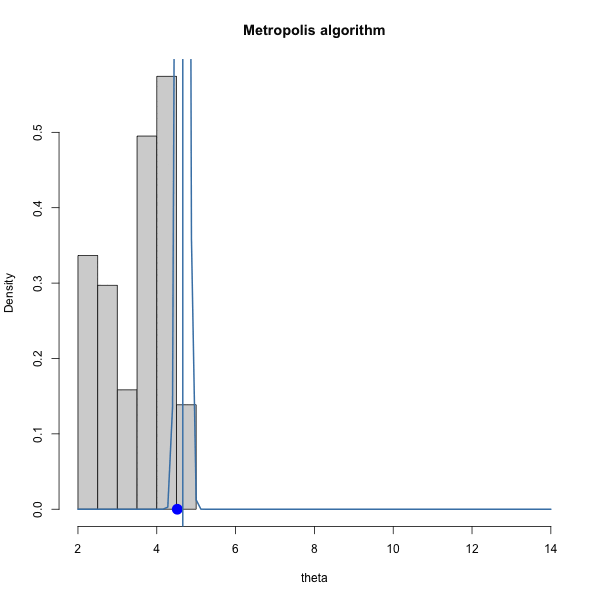
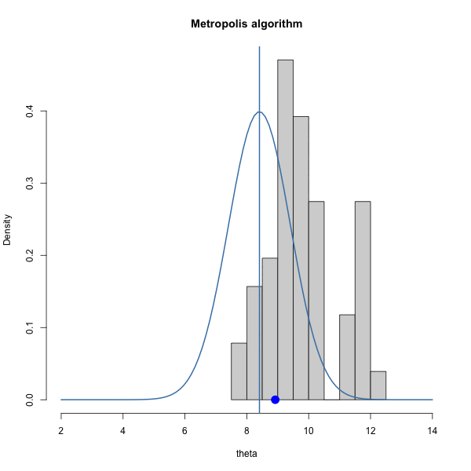
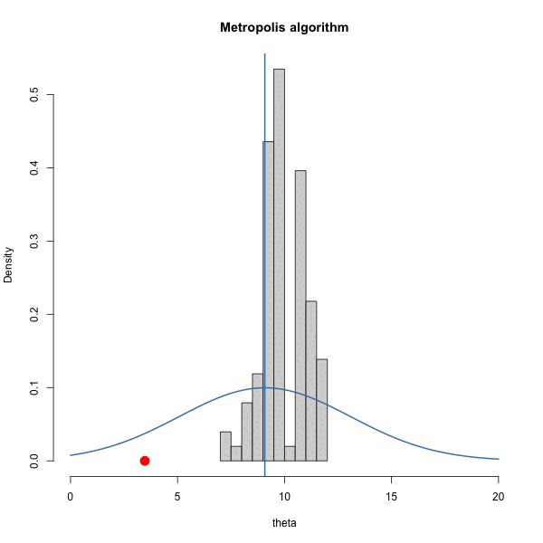

## Today

By the end, you should be able to:

1. Explain why we might use a Markov chain for Monte Carlo simulation.
2. Describe the **Metropolis algorithm** in words and code.
3. Explain the roles of irreducibility, aperiodicity, and stationarity.
4. Use traceplots and acceptance rates to recognize obvious problems.
5. Explain burn-in and why starting values can matter.
6. Describe how MCMC can be used to break a substitution cipher.


## Motivation

{width="75%"}

[Diaconis, Persi. "The Markov chain Monte Carlo revolution." Bulletin of the American Mathematical Society 46.2 (2009): 179-205.](https://math.uchicago.edu/~shmuel/Network-course-readings/MCMCRev.pdf)


## Basic cryptology terminology

-   cryptography: making secret messages (encryption)
    -   substitution
    -   transposition
-   cryptanalysis: breaking secret messages (decryption)
-   cryptology: the study of cryptography and cryptanalysis

. . .

-   plain text: the actual message
-   cipher text: the encrypted message
-   key: information to encode (or decode) cryptographic key
  - symmetric (same key for encryption and decryption)
  - asymmetric (different key to encrypt and decrypt)

## Substitution cipher

-   Idea: each character of plaintext is substituted with another character

. . .

Example:

{fig-align="center" width="600"}

From <https://en.wikipedia.org/wiki/Substitution_cipher>

## Brute force approach?

<!-- - Given the message below is encoded with a substitution cipher, how many possible keys are there? -->

<!-- Here's a secret message. We'll assume it's encrypted with the -->

<!-- ```{r} -->
<!-- #| echo: false -->
<!-- #| warning: false -->
<!-- #| message: false -->
<!-- secret_message = readLines("../data/ciphertext.txt") -->
<!-- ``` -->


<!-- ```{r} -->
<!-- secret_message -->
<!-- ``` -->

- Trying every possible key is known as a "brute force" approach. 

. . . 

Since every key is a permutation of the alphabet, there are

$$
26!
$$

possible keys.

```{r}
factorial(26)
```

If you're computer could "try" 1 million keys per second, it would still take `r factorial(26)/(1e6 * 60 * 60 * 24)` years to try every possible key and guarantee a solution.

. . .

- Chat with your neighbor and develop a strategy better than the brute force approach.

<!-- - Continue the exercise by downloading the file below -->

<!-- ```{r} -->
<!-- #| eval: false -->
<!-- download.file(url = "https://sta323-sp23.github.io/scripts/cryptanalysis.qmd", -->
<!--               destfile = "cryptanalysis.qmd") -->
<!-- ``` -->


```{r setup}
#| include: false
library(tidyverse)
library(latex2exp)
library(patchwork)
set.seed(323)
theme_set(theme_minimal(base_size = 18))

target_score <- function(x) {
  exp(-0.5 * ((x - 3) / 1.2)^2)
}

metropolis <- function(n_steps = 5000,
                       start = 0,
                       proposal_sd = 1) {

  x <- numeric(n_steps)
  accepted <- logical(n_steps)

  x[1] <- start

  for (t in 2:n_steps) {

    proposal <- rnorm(
      1,
      mean = x[t - 1],
      sd = proposal_sd
    )

    ratio <- target_score(proposal) /
      target_score(x[t - 1])

    accept_prob <- min(1, ratio)

    if (runif(1) < accept_prob) {
      x[t] <- proposal
      accepted[t] <- TRUE
    } else {
      x[t] <- x[t - 1]
    }
  }

  tibble(
    iteration = 1:n_steps,
    x = x,
    accepted = accepted
  )
}
```

## Some keys are much better than others

Suppose one candidate key produces

```text
THERE IS NO WAR IN BA SING SE
```

and another produces

```text
ZITKT OL FG CQK OF WQ LOFU LT
```

The first looks much more like English.

We can create a numerical score:

$$
S(\text{key})
=
\text{how English-like is the decoded text?}
$$

Higher score = more plausible key.

## Instead of searching every key

We could:

1. Start with one candidate key.
2. Make a **small random change**.
3. Decode the message.
4. Compare the new score with the current score.
5. Decide whether to move to the new key.
6. Repeat.

This creates a sequence of candidate keys.

. . .

If the moves in "key space" are only based on the current position, the sequence will be a **Markov chain**.

## Recall: the Markov property

A Markov chain is a sequence

$$
X_1, X_2, X_3, \ldots
$$

where the next state depends on the current state:

$$
P(X_{t+1}\mid X_t,X_{t-1},\ldots)
=
P(X_{t+1}\mid X_t).
$$

For cryptanalysis,

$$
X_t = \text{candidate key at iteration } t.
$$

## Recall: stationary distributions

For a long Markov chain, the fraction of time spent in state $j$ can estimate
its stationary probability:

$$
\widehat{\pi}_j
=
\frac{\text{number of visits to state }j}
     {\text{number of iterations}}.
$$

This suggests a powerful idea:

> What if we construct a chain whose stationary distribution favors the states
> we want to find?

## Markov chain Monte Carlo

**Markov chain Monte Carlo (MCMC)** means:

> Construct a Markov chain whose long-run distribution is a distribution we
> want to explore.

Then use the states visited by the chain as simulated draws.

For cryptanalysis, we want:

- high-scoring keys visited often,
- low-scoring keys visited rarely.

## A target distribution

Suppose every possible state $x$ has a nonnegative score

$$
f(x).
$$

We want stationary probabilities proportional to those scores:

$$
\pi(x) \propto f(x).
$$

The symbol $\propto$ means **proportional to**.

We do not need to know the constant that makes all the probabilities sum to 1.

## Why proportional is enough

Suppose

$$
\pi(x)
=
\frac{f(x)}{C}
$$

for some unknown constant $C$.

Then

$$
\frac{\pi(x^\star)}{\pi(x)}
=
\frac{f(x^\star)}{f(x)}.
$$

The unknown constant cancels.

That is one reason MCMC is useful when a target is easy to **score** but hard to
sample from directly.

## One Metropolis step

Suppose the chain is currently at $x$.

1. Propose a nearby state $x^\star$.
2. Calculate

$$
r
=
\frac{f(x^\star)}{f(x)}.
$$

3. Accept the proposal with probability

$$
\min(1,r).
$$

Otherwise, remain at $x$.

## Why accept worse proposals?

If $f(x^\star) > f(x)$, then $r>1$, so the proposal is always accepted.

If $f(x^\star) < f(x)$, it can still be accepted.

For example, if

$$
r=0.8,
$$

we accept the worse proposal with probability $0.8$.

If we accepted only improvements, we could become trapped at a local optimum.

## The Metropolis algorithm in R

```{r}
#| eval: false
for (t in 2:n_steps) {

  proposal <- propose(current)

  ratio <- target_score(proposal) /
    target_score(current)

  accept_prob <- min(1, ratio)

  if (runif(1) < accept_prob) {
    current <- proposal
  }

  chain[t] <- current
}
```

After a rejection, `current` does not change.

## A note on numerical stability

Practically, we want to avoid computing 

```
  ratio <- target_score(proposal) /
    target_score(current)
```

directly, because it could be numerically unstable for very small/large `target_score()`. To make things more stable, we always `log` the ratio and modify the code as such:

```{r}
#| eval: false
for (t in 2:n_steps) {

  proposal <- propose(current)

  log_ratio <- log_target_score(proposal) -
    log_target_score(current)

  if (log(runif(1)) < log_ratio) {
    current <- proposal
  }

  chain[t] <- current
}
```

# Toy example

## A simple target

Before returning to cryptanalysis, consider

$$
f(x)
=
\exp\left[
-\frac{1}{2}
\left({x-10}\right)^2
\right].
$$

::: panel-tabset

## Plot
```{r}
#| echo: false
tibble(x = seq(5, 15, length.out = 300)) |>
  ggplot(aes(x = x)) +
  stat_function(fun = dnorm, args = list(mean = 10, sd = 1), linewidth = 1) +
  labs(
    y = "Target score",
    title = "Where should the chain spend its time?"
  )
```

## Code

```{r}
#| eval: false
tibble(x = seq(-3, 9, length.out = 300)) |>
  ggplot(aes(x = x)) +
  stat_function(fun = target_score, linewidth = 1) +
  labs(
    y = "Target score",
    title = "Where should the chain spend its time?"
  )
```
:::

The target is largest near $x=10$.

## Propose a nearby state

Use a random step around the current position:

$$
X^\star
\sim
N(X_t,\sigma^2).
$$

```{r}
#| eval: false
proposal <- rnorm(
  1,
  mean = current,
  sd = proposal_sd
)
```

This is a **random-walk proposal**.

## A complete Metropolis function

<!-- # ```{r} -->
<!-- # #| eval: false -->
<!-- # metropolis <- function(n_steps = 5000, -->
<!-- #                        start = 0, -->
<!-- #                        proposal_sd = 1) { -->
<!-- # -->
<!-- #   x <- numeric(n_steps) -->
<!-- #   accepted <- logical(n_steps) -->
<!-- #   x[1] <- start -->
<!-- # -->
<!-- #   for (t in 2:n_steps) { -->
<!-- # -->
<!-- #     proposal <- rnorm(1, x[t - 1], proposal_sd) -->
<!-- # -->
<!-- #     log_ratio <- log(target_score(proposal)) - -->
<!-- #       log(target_score(x[t - 1])) -->
<!-- # -->
<!-- #     if (log(runif(1)) < log_ratio) { -->
<!-- #       x[t] <- proposal -->
<!-- #       accepted[t] <- TRUE -->
<!-- #     } else { -->
<!-- #       x[t] <- x[t - 1] -->
<!-- #     } -->
<!-- #   } -->
<!-- # -->
<!-- #   tibble(iteration = 1:n_steps, x, accepted) -->
<!-- # } -->
<!-- # ``` -->

```{r}
log_target_score <- function(x) {
  -0.5 * (x - 10)^2
}

metropolis <- function(n_steps = 5000,
                       start = 0,
                       proposal_sd = 1) {

  x <- numeric(n_steps) # something to save state of chain
  accepted <- logical(n_steps) # something to save whether accepted or not
  x[1] <- start # starting position of chain

  for (t in 2:n_steps) {
    proposal <- rnorm(1, x[t - 1], proposal_sd)

    log_ratio <- log_target_score(proposal) -
      log_target_score(x[t - 1])

    if (log(runif(1)) < log_ratio) {
      x[t] <- proposal
      accepted[t] <- TRUE
    } else {
      x[t] <- x[t - 1]
    }
  }

  tibble(iteration = 1:n_steps, x, accepted)
}
```


<!-- ```{r} -->
<!-- #| echo: true -->
<!-- #| eval: true -->
<!-- set.seed(323) -->

<!-- metropolis <- function(n_steps = 5000, -->
<!--                        start = 0, -->
<!--                        proposal_sd = 1) { -->
<!--   theta_s = start # starting point -->
<!--   THETA = NULL # empty object to save iterations in -->
<!--   S = n_steps # number of iterations -->
<!--   delta = proposal_sd # proposal sd -->
<!--   accept = 0 # keep track of acceptance rate -->
<!--   ACCEPTED = NULL -->

<!--   for (s in 1:S) { -->

<!--     accepted <- FALSE -->
<!--     # log everything for numerical stability # -->

<!--     ### generate proposal and compute ratio r ### -->
<!--     theta_proposal = rnorm(1, mean = theta_s, sd = delta) -->
<!--     log.r = dnorm(theta_proposal, -->
<!--                   mean = 10, -->
<!--                   sd = 1, -->
<!--                   log = TRUE) - -->
<!--       dnorm(theta_s, -->
<!--             mean = 10, -->
<!--             sd = 1, -->
<!--             log = TRUE) -->

<!--     ### accept or reject proposal and add to chain ### -->
<!--     if (log(runif(1)) < log.r)  { -->
<!--       theta_s = theta_proposal -->
<!--       accepted = TRUE -->
<!--     } -->
<!--     THETA = c(THETA, theta_s) -->
<!--     ACCEPTED <- c(ACCEPTED, accepted) -->
<!--   } -->
<!--   tibble(iteration = 1:n_steps, THETA, accepted = ACCEPTED)  -->
<!-- } -->
<!-- ``` -->

## Run the chain

:::: {.columns}

::: {.column width="50%"}
```{r}
chain <- metropolis(
  n_steps = 5000,
  start = -3,
  proposal_sd = 1
)

chain
```

:::

::: {.column width="50%"}
- These simulations are **dependent**.

- Each state was generated using the previous state.

- The hope is that their long-run distribution is still the target distribution.
:::

::::

## Do we reach the target?

::: panel-tabset
## Plot
```{r}
#| echo: false
chain |>
  ggplot(aes(x = x)) +
  geom_histogram(
    aes(y = after_stat(density)),
    bins = 40
  ) +
  stat_function(
    fun = function(x) dnorm(x, mean = 10, sd = 1),
    linewidth = 1
  ) +
  labs(
    x = "x",
    y = "Density",
    title = "Markov chain histogram"
  )
```

## Code
```{r}
#| echo: true
#| eval: false
chain |>
  ggplot(aes(x = x)) +
  geom_histogram(
    aes(y = after_stat(density)),
    bins = 40
  ) +
  stat_function(
    fun = function(x) dnorm(x, mean = 10, sd = 1),
    linewidth = 1
  ) +
  labs(
    x = "x",
    y = "Density",
    title = "Markov chain histogram"
  )
```
:::

The histogram should approximately follow the target shape.

## Acceptance rate

The **acceptance rate** is the fraction of proposed moves that were accepted.

```{r}
mean(chain$accepted)
```

Very low acceptance can mean the chain is repeatedly proposing moves that are
too large.

Very high acceptance can occur when proposed moves are so small that the chain
moves only very slowly.

## Different proposal standard deviation

<!-- We have to choose the proposal standard deviation, $\delta$. How should we choose it? Let's gain some intuition by trying out three different values of $\delta$. -->

```{r}
#| echo: false
#| eval: true
set.seed(323)
theta_s = 0 # starting point
THETA = NULL
THETA_P = NULL # empty object to save iterations in
S = 10000 # number of iterations
delta = 1 # proposal variance
accept = 0 # keep track of acceptance rate

for (s in 1:S) {
  # log everything for numerical stability #
  
  ### generate proposal and compute ratio r ###
  theta_proposal = rnorm(1, mean = theta_s, sd = delta) 
  log.r = dnorm(theta_proposal, mean = 10, sd = 1, log = TRUE) - 
    dnorm(theta_s, mean = 10, sd = 1, log = TRUE)
  
  ### accept or reject proposal and add to chain ###
  if(log(runif(1)) < log.r)  {
    theta_s = theta_proposal
    accept = accept + 1 
  }
  THETA = c(THETA, theta_s)
  THETA_P = c(THETA_P, theta_proposal)
}
```

```{r}
#| echo: false
#| eval: false

BEGIN = 50
END = 150

df = data.frame(theta = THETA,
                proposed = THETA_P)

df2 = df %>%
  slice_tail(n = -BEGIN)

saveGIF(
  {
for (i in (BEGIN+1):END) {
  df2 %>%
    slice_head(n = i) %>%
    pull(theta) %>%
    hist(freq = FALSE, xlim = c(2, 14), main = "Metropolis algorithm", xlab = "theta")
    curve(dnorm(x, mean=df2$theta[i], sd=1), 
          col="steelblue", lwd=2, add=TRUE, yaxt="n")
    if(df2$proposed[i+1] == df2$theta[i+1]) {
    points(x = df2$proposed[i+1],
       y = 0, pch = 16, cex = 2, col = "blue")
    }
    else {
      points(x = df2$proposed[i+1],
       y = 0, pch = 16, cex = 2, col = "red")
    }
    abline(v = df2$theta[i], col = "steelblue", lwd = 2)
  # p = df2 %>%
  #   slice_head(n = i) %>%
  #   ggplot(aes(x = theta)) +
  #   xlim(c(5, 15)) +
  #   ylim(c(0, 0.4)) +
  #   geom_histogram(aes(y = ..density..), breaks = seq(0,max(df$theta)+.5,.5)) +
  #   stat_function(fun = dnorm, args = list(mean = df$theta[i], sd = 1), col = "steelblue") +
  # geom_point(aes(x = theta[i], y = 0), col = "steelblue")
  # print(p)
}
  },
movie.name = "metropolis-normal-1.gif",
interval = 2,
ani.width = 600,
ani.height = 600,
outdir = getwd()
)
```

```{r}
#| eval: false
#| echo: false
# DIFFERENT DELTA ##

set.seed(360)
theta_s = 0 # starting point
THETA = NULL
THETA_P = NULL # empty object to save iterations in
S = 1000 # number of iterations
delta = 4 # proposal variance
accept = 0 # keep track of acceptance rate

for (s in 1:S) {
  # log everything for numerical stability #
  
  ### generate proposal and compute ratio r ###
  theta_proposal = rnorm(1, mean = theta_s, sd = delta) 
  log.r = dnorm(theta_proposal, mean = 10, sd = 1, log = TRUE) - 
    dnorm(theta_s, mean = 10, sd = 1, log = TRUE)
  
  ### accept or reject proposal and add to chain ###
  if(log(runif(1)) < log.r)  {
    theta_s = theta_proposal
    accept = accept + 1 
  }
  THETA = c(THETA, theta_s)
  THETA_P = c(THETA_P, theta_proposal)
}

## ANIMATION ##

BEGIN = 100
END = 150

df = data.frame(theta = THETA,
                proposed = THETA_P)

df2 = df %>%
  slice_tail(n = -BEGIN)

saveGIF(
  {
for (i in (BEGIN+1):END) {
  df2 %>%
    slice_head(n = i) %>%
    pull(theta) %>%
    hist(freq = FALSE, xlim = c(0, 20), main = "Metropolis algorithm", xlab = "theta")
    curve(dnorm(x, mean=df2$theta[i], sd=delta), 
          col="steelblue", lwd=2, add=TRUE, yaxt="n")
    if(df2$proposed[i+1] == df2$theta[i+1]) {
    points(x = df2$proposed[i+1],
       y = 0, pch = 16, cex = 2, col = "blue")
    }
    else {
      points(x = df2$proposed[i+1],
       y = 0, pch = 16, cex = 2, col = "red")
    }
    abline(v = df2$theta[i], col = "steelblue", lwd = 2)
  # p = df2 %>%
  #   slice_head(n = i) %>%
  #   ggplot(aes(x = theta)) +
  #   xlim(c(5, 15)) +
  #   ylim(c(0, 0.4)) +
  #   geom_histogram(aes(y = ..density..), breaks = seq(0,max(df$theta)+.5,.5)) +
  #   stat_function(fun = dnorm, args = list(mean = df$theta[i], sd = 1), col = "steelblue") +
  # geom_point(aes(x = theta[i], y = 0), col = "steelblue")
  # print(p)
}
  },
movie.name = "metropolis-normal-delta4.gif",
interval = 2,
ani.width = 600,
ani.height = 600,
outdir = getwd()
)
```

```{r}
#| eval: false
#| echo: false
# DIFFERENT DELTA ##

set.seed(360)
theta_s = 0 # starting point
THETA = NULL
THETA_P = NULL # empty object to save iterations in
S = 1000 # number of iterations
delta = 0.1 # proposal variance
accept = 0 # keep track of acceptance rate

for (s in 1:S) {
  # log everything for numerical stability #
  
  ### generate proposal and compute ratio r ###
  theta_proposal = rnorm(1, mean = theta_s, sd = delta) 
  log.r = dnorm(theta_proposal, mean = 10, sd = 1, log = TRUE) - 
    dnorm(theta_s, mean = 10, sd = 1, log = TRUE)
  
  ### accept or reject proposal and add to chain ###
  if(log(runif(1)) < log.r)  {
    theta_s = theta_proposal
    accept = accept + 1 
  }
  THETA = c(THETA, theta_s)
  THETA_P = c(THETA_P, theta_proposal)
}

## ANIMATION ##

BEGIN = 100
END = 150

df = data.frame(theta = THETA,
                proposed = THETA_P)

df2 = df %>%
  slice_tail(n = -BEGIN)

saveGIF(
  {
for (i in (BEGIN+1):END) {
  df2 %>%
    slice_head(n = i) %>%
    pull(theta) %>%
    hist(freq = FALSE, xlim = c(2, 14), main = "Metropolis algorithm", xlab = "theta")
    curve(dnorm(x, mean=df2$theta[i], sd=delta), 
          col="steelblue", lwd=2, add=TRUE, yaxt="n")
    if(df2$proposed[i+1] == df2$theta[i+1]) {
    points(x = df2$proposed[i+1],
       y = 0, pch = 16, cex = 2, col = "blue")
    }
    else {
      points(x = df2$proposed[i+1],
       y = 0, pch = 16, cex = 2, col = "red")
    }
    abline(v = df2$theta[i], col = "steelblue", lwd = 2)
}
  },
movie.name = "metropolis-normal-delta-point1.gif",
interval = 2,
ani.width = 600,
ani.height = 600,
outdir = getwd()
)
```

<!-- Let's look at how various $\delta$ let us sample the target: -->

::: panel-tabset
## $\delta = 0.1$



## $\delta = 1$



## $\delta = 4$


:::

## Trace plots

Let's look at the trace plots for each $\delta$. A **traceplot** shows the state of the chain against iteration.

```{r}
#| echo: false
#| warning: false
set.seed(360)
theta_s1 = 0 # starting point
theta_s2 = 0
theta_s3 = 0
THETA_1 = NULL
THETA_2 = NULL
THETA_3 = NULL
S = 2000 # number of iterations
delta1 = 1 # proposal sd
delta2 = 4
delta3 = 0.1
accept1 = 0 # keep track of acceptance rate
accept2 = 0
accept3 = 0
for (s in 1:S) {
  # log everything for numerical stability #
  
  ### generate proposal and compute ratio r ###
  theta_proposal_1 = rnorm(1, mean = theta_s1, sd = delta1) 
  log.r = dnorm(theta_proposal_1, mean = 10, sd = 1, log = TRUE) - 
    dnorm(theta_s1, mean = 10, sd = 1, log = TRUE)
  
  ### accept or reject proposal and add to chain ###
  if(log(runif(1)) < log.r)  {
    theta_s1 = theta_proposal_1
    accept1 = accept1 + 1 
  }
  THETA_1 = c(THETA_1, theta_s1)
  
  ## SECOND DELTA ##
  ##################
   ### generate proposal and compute ratio r ###
  theta_proposal_2 = rnorm(1, mean = theta_s2, sd = delta2) 
  log.r = dnorm(theta_proposal_2, mean = 10, sd = 1, log = TRUE) - 
    dnorm(theta_s2, mean = 10, sd = 1, log = TRUE)
  
  ### accept or reject proposal and add to chain ###
  if(log(runif(1)) < log.r)  {
    theta_s2 = theta_proposal_2
    accept2 = accept2 + 1 
  }
  THETA_2 = c(THETA_2, theta_s2)
  
  ### THIRD DELTA ###
  ###################
   theta_proposal_3 = rnorm(1, mean = theta_s3, sd = delta3) 
  
  log.r = dnorm(theta_proposal_3, mean = 10, sd = 1, log = TRUE) - 
    dnorm(theta_s3, mean = 10, sd = 1, log = TRUE)
  
  ### accept or reject proposal and add to chain ###
  if(log(runif(1)) < log.r)  {
    theta_s3 = theta_proposal_3
    accept3 = accept3 + 1 
  }
  THETA_3 = c(THETA_3, theta_s3)
}
```


```{r}
#| echo: false
#| warning: false

df = data.frame(theta1 = THETA_1,
                theta2 = THETA_2,
                theta3 = THETA_3)
p1 = df %>%
  ggplot(aes(x = 1:nrow(df), y = theta1)) + 
  geom_line() + 
  theme_bw() +
  labs(x = "iteration", y = TeX("\\theta"), title = TeX("$\\delta = 1$"))

p2 = df %>%
  ggplot(aes(x = 1:nrow(df), y = theta2)) + 
  geom_line() + 
  theme_bw() +
  labs(x = "iteration", y = TeX("\\theta"), title = TeX("$\\delta = 4$"))

p3 = df %>%
  ggplot(aes(x = 1:nrow(df), y = theta3)) + 
  geom_line() + 
  theme_bw() +
  labs(x = "iteration", y = TeX("\\theta"), title = TeX("$\\delta = 0.1$"))

# p3 + p1 + p2
```

::: panel-tabset

## delta = 0.1

```{r}
#| echo: false
p3
```

## delta = 1
```{r}
#| echo: false
p1
```
## delta = 4
```{r}
#| echo: false
p2
```

## table

```{r}
#| echo: false
#| warning: false
S = 2000
df_accept = data.frame(accept3 / S, accept1 / S, accept2 / S)
df_accept %>%
  knitr::kable(caption = "Acceptance rate for each delta", digits = 2, col.names = c("0.1", "1", "4"),
        )
```

Want: traceplots to look like fuzzy caterpillars.
:::


## Intuition: blind monkey on an island

:::: {.columns}

::: {.column width="50%"}
{width="100%"}
:::

::: {.column width="50%"}
{width="100%"}
:::

::::

# MCMC Vocab

## Will we reach stationarity?

For a discrete state Markov chain, such as the cryptanalysis example we consider, **irreducibility**, **positive recurrence**, and **aperiodicity** guarantee a unique stationary distribution and convergence to it in infinite time.

. . . 

Recall:

- irreducible: every state can eventually be reached from every other state

- positive recurrence: starting from any state, the chain returns to that state eventually with probability 1. 

. . . 

New: 

- aperiodic: the chain is not forced to revisit states only at regularly
  spaced times.


## Why Metropolis often gives aperiodicity

When a Metropolis proposal is rejected,

$$
X_{t+1}=X_t.
$$

The chain can remain in the same state.

For an irreducible chain, the ability to stay put is a simple way to obtain
aperiodicity.

<!-- ## Traceplots -->

<!-- A **traceplot** shows the state of the chain against iteration. -->

<!-- ```{r} -->
<!-- chain |> -->
<!--   ggplot(aes(x = iteration, y = x)) + -->
<!--   geom_line() + -->
<!--   labs( -->
<!--     x = "Iteration", -->
<!--     y = "State", -->
<!--     title = "Traceplot" -->
<!--   ) -->
<!-- ``` -->

<!-- A useful chain should repeatedly move around the important region rather than -->
<!-- remaining stuck in one place. -->

## Starting values and burn-in

Our chain started far from the center of the target.

Early iterations can therefore reflect the arbitrary starting value.

A common strategy is to discard an initial portion:

```{r}
burn_in <- 500

chain_kept <- chain |>
  filter(iteration > burn_in)
```

This discarded portion is called **burn-in** or **warm-up**.

There is no universal correct number of iterations to discard.

Practically, we might examine the traceplot to visually inspect when we plausibly reach stationarity.


<!-- Acceptance rate is a diagnostic, not necessarily a goal by itself. -->

<!-- ## Proposal size changes the behavior -->

<!-- ```{r} -->
<!-- large_steps <- metropolis( -->
<!--   n_steps = 3000, -->
<!--   proposal_sd = 20 -->
<!-- ) -->

<!-- small_steps <- metropolis( -->
<!--   n_steps = 3000, -->
<!--   proposal_sd = .03 -->
<!-- ) -->
<!-- ``` -->

<!-- Large steps: -->

<!-- - many rejections, -->
<!-- - long flat stretches. -->

<!-- Tiny steps: -->

<!-- - many acceptances, -->
<!-- - slow movement through the target. -->

<!-- Both can lead to poor exploration. -->

## Mixing

A chain **mixes well** when it moves efficiently through the important parts
of the target distribution.

Warning signs of poor mixing include:

- long flat stretches,
- very slow wandering,
- important regions visited only rarely.

No single plot or statistic proves that a chain has mixed well.

## Multiple starting values

Run several chains from very different places:

```{r}
starts <- c(-8, 0, 8, 15)

chains <- map_dfr(
  starts,
  function(s) {
    metropolis(
      n_steps = 2500,
      start = s,
      proposal_sd = 1
    ) |>
      mutate(start = factor(s))
  }
)
```

If all chains eventually explore the same region, that is reassuring.

<!-- ## Compare the chains -->

<!-- ```{r} -->
<!-- chains |> -->
<!--   ggplot( -->
<!--     aes( -->
<!--       x = iteration, -->
<!--       y = x, -->
<!--       group = start -->
<!--     ) -->
<!--   ) + -->
<!--   geom_line(alpha = .6) + -->
<!--   facet_wrap(~ start, ncol = 1) + -->
<!--   labs( -->
<!--     x = "Iteration", -->
<!--     y = "State" -->
<!--   ) -->
<!-- ``` -->

<!-- If chains started in different places remain in completely different regions, -->
<!-- we may be concerned. -->

# Return to cryptanalysis example 

## Cryptanalysis: the state and proposal

For the substitution cipher,

$$
X_t
=
\text{current substitution key}.
$$

A simple proposal is:

> Pick two letters at random and swap their assignments.

Any permutation can be transformed into any other permutation through a
sequence of swaps.

So this proposal can, in principle, reach every possible key.

That gives us **irreducibility**.

## Score the decoded message

We need a score that rewards English-looking text.

One approach uses frequencies of neighboring letters.

Common patterns such as

```text
TH  HE  IN  ER  AN
```

receive higher scores than unusual patterns such as

```text
QZ  ZX  JQ
```

Combine these contributions across the decoded message to obtain an
**English log-score**.

## Cryptanalysis pseudocode

```{r}
#| eval: false
current_key <- initial_key
current_score <- score(decode(ciphertext, current_key))

for (t in 2:n_steps) {

  proposed_key <- swap_two_letters(current_key)

  proposed_score <-
    score(decode(ciphertext, proposed_key))

  accept_prob <- min(
    1,
    exp(proposed_score - current_score)
  )

  if (runif(1) < accept_prob) {
    current_key <- proposed_key
    current_score <- proposed_score
  }

  chain[[t]] <- current_key
  scores[t] <- current_score
}
```

## Try it yourself

```{r}
#| eval: false
download.file(
  url = "https://sta323-fa26.github.io/scripts/cryptanalysis-exercise.qmd",
              destfile = "cryptanalysis-exercise.qmd")
```


## What should we plot?

The state is a 26-letter permutation, so a direct traceplot of the state is not
useful.

Instead, plot the **English score**:

```{r}
#| eval: false
tibble(
  iteration = 1:n_steps,
  score = scores
) |>
  ggplot(aes(iteration, score)) +
  geom_line()
```

We want to see the chain reach and continue exploring high-scoring keys.

## Diagnostics for the cipher chain

Useful checks include:

- **Traceplot:** does the English score settle into a high-scoring region?
- **Acceptance rate:** are nearly all swaps rejected?
- **Multiple starts:** do different random keys find similar decryptions?
- **Best decoded text:** does it actually look like English?
- **Longer run:** does running longer materially change the result?

For cryptanalysis, the decoded text itself is an unusually useful diagnostic.

## Burn-in for the cipher

A random starting key usually decodes to nonsense.

The beginning of the chain mostly describes its trip away from that arbitrary
starting key.

We may discard an initial section:

```{r}
#| eval: false
kept_scores <- scores[-(1:burn_in)]
kept_keys <- chain[-(1:burn_in)]
```

The traceplot should help us judge whether the early behavior looks different
from the later behavior.

## MCMC or optimization?

For cryptanalysis, we may care most about the **best key found**:

```{r}
#| eval: false
best_iteration <- which.max(scores)
best_key <- chain[[best_iteration]]
```

So this application has an optimization flavor.

But MCMC's defining goal is broader:

> Construct a chain with a chosen stationary distribution and use its visited
> states for Monte Carlo calculations.

## Why this is Monte Carlo

Once the chain is exploring its stationary distribution, we can estimate an
average under the target using

$$
\frac{1}{N}
\sum_{t=1}^N h(X_t).
$$

This looks like ordinary Monte Carlo.

The key difference is:

> The simulated values are dependent because they come from a Markov chain.

Hence: "Markov chain Monte Carlo"

<!-- ## Exercise -->

<!-- Return to the cryptanalysis problem. -->

<!-- Suppose your chain has a very low acceptance rate and its score traceplot has -->
<!-- long flat stretches. -->

<!-- Discuss with a neighbor: -->

<!-- 1. What is likely happening to the proposed keys? -->
<!-- 2. How could you change the proposal mechanism? -->
<!-- 3. Why would accepting only proposals with a higher English score be risky? -->
<!-- 4. Why might running several chains from different random keys be useful? -->

## References

- Diaconis, P. (2009). "The Markov chain Monte Carlo revolution." *Bulletin of the American Mathematical Society*, 46(2), 179--205.
- Metropolis, N., Rosenbluth, A. W., Rosenbluth, M. N., Teller, A. H., & Teller, E. (1953). "Equation of state calculations by fast computing machines." *Journal of Chemical Physics*, 21, 1087--1092.
